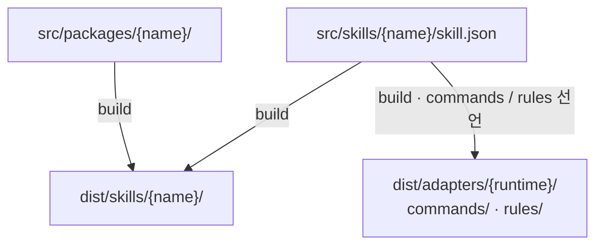
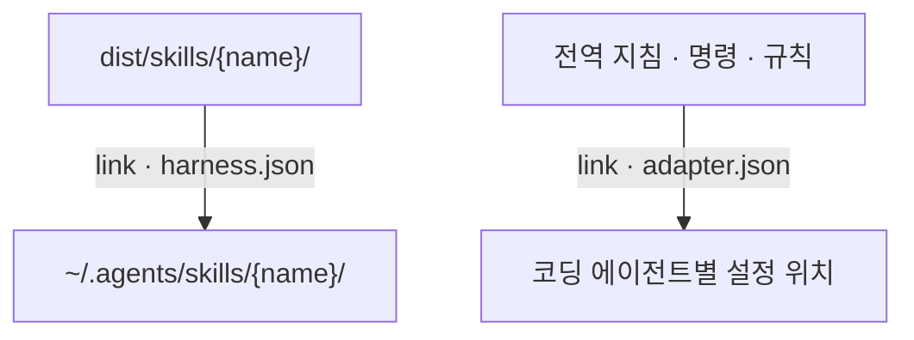
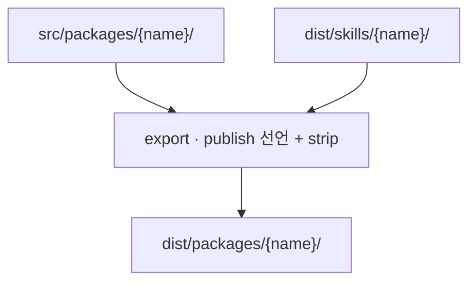

# harness

개인 에이전트 하네스

코딩 에이전트에게 도입을 맡기려면 [에이전트를 통한 하네스 도입](src/docs/harness/guides/agent-onboarding.md)을 따라 현재 머신에 설치·적용해 달라고 요청한다.

## 폴더

```
harness/
  AGENTS.md            전역 지침
  harness.json         하네스 manifest
  src/                 원본 모음
    docs/<domain>/     관심사별 원본 문서 모음
      harness/         단, 이곳은 이 레포에 대한 문서 모음
    docs/templates/    문서 타입별 템플릿
    skills/<name>/     스킬별 원본
      skill.json       스킬 manifest
      assets/          번들에 실어 보낼 에셋
      scripts/         스킬 실행, 검증 코드
    packages/<name>/   이 레포에서 개발하는 standalone 패키지
    hooks/             훅 스크립트 원본
    bootstrap/         프로젝트 초기화용 공통 파일
    adapters/<runtime>/ 런타임 어댑터
  dist/                산출물, 커밋은 하되 직접 편집하지 않음
    skills/<name>/     생성된 스킬
    adapters/<rt>/     생성된 명령과 규칙
    packages/<name>/   외부 배포 스냅샷
  scripts/             build · check · export · link · configure · init-project
```

## 규칙

- 원칙·결정·절차는 [`principles`](src/docs/harness/conventions/principles.md)가 소유한다.
- `dist/`는 스크립트의 산출물이 담기는 곳으로 직접 편집하지 않는다.
- 코딩 에이전트 런타임에 관한 내용은 `src/adapters/<runtime>/` 밖에 두지 않는다.

## 흐름

### build — 원본에서 에이전트용 파일 생성



- manifest에 선언된 내용에 따라 문서·assets·scripts를 번들로 묶는다.
- 명령과 규칙은 선언한 경우에만 생성한다.
- standalone 패키지는 자체 `SKILL.md`와 `references/`를 복사한다.
- 번들 내 문서 링크는 배포 위치에 맞게 고친다.
- 번들 외 파일은 저장소 URL로 바꾸고 경고하며, 없는 파일을 가리키면 오류로 처리한다.
- 프로젝트별 값은 프로필로 분리한다. 스킬은 프로젝트의 `docs/profiles/<name>.md`를 먼저 읽고, 없으면 번들에 포함된 기본값을 쓴다.

### link — 코딩 에이전트가 읽는 위치에 연결



- 공용 스킬 연결은 `harness.json`이, 런타임별 연결은 각 `adapter.json`이 정한다.
- `link`는 파일을 복사하지 않고 symlink를 만든다.
- 앱도 수정하는 JSON 설정과 훅 등록은 `configure`로 관리 항목만 적용한다. 전체 파일을 symlink하지 않는다.

### export — 외부 배포용 스냅샷 생성



- `publish.<name>.from`이 배포 원본을 정하고 `strip`이 제외 파일을 정한다.
- 릴리스 태그는 `<name>-v<version>` 형식으로 별도 발행한다. 원본이 바뀌어도 발행한 스냅샷은 다음 릴리스까지 유지한다.
- `check`는 스킬 생성물이 원본과 다르면 오류, 릴리스 스냅샷이 원본보다 뒤처지면 export 대기, 스냅샷을 직접 수정한 경우에는 오류로 처리한다.

설치 명령과 버전별 배포 절차는 [릴리스와 외부 배포](src/docs/harness/guides/release.md)를 따른다.

## 에이전트가 지침을 읽는 시점

모든 지침을 한꺼번에 읽지 않고, 적용 범위에 따라 세 방식으로 전달한다.

| 읽는 시점 | 담는 내용 | 예시 |
| --- | --- | --- |
| 작업 시작 시 항상 | 모든 작업에 적용할 공통 지침 | 루트 `AGENTS.md`를 Claude Code의 `~/.claude/CLAUDE.md`, Codex의 `~/.codex/AGENTS.md`로 연결 |
| 특정 파일을 다룰 때 | 파일 경로·종류에 맞는 규칙 | `**/*.ts`를 다룰 때 TypeScript 규칙 로드. 해당 기능을 지원하는 런타임에 전달 |
| 요청이 스킬의 사용 조건에 맞을 때 | 작업별 절차와 상세 기준 | 코드 리뷰 요청에 `code-review` 스킬을 선택하고 `SKILL.md`와 참조 문서를 읽음 |

공통 지침은 짧게 유지하고, 파일별 규칙과 작업별 절차는 필요한 시점에 읽도록 나눈다.

## 문서 분류와 스킬 선택

### 문서 분류 — domain

원본 문서는 `src/docs/common/`, `src/docs/web/`처럼 관심사별 도메인 폴더에 나눠 둔다. 배포된 스킬은 `dist/skills/code-review/`처럼 도메인 구분 없이 스킬 이름으로 배치한다.

build는 스킬에 포함된 문서들의 `domain`을 모아 생성된 `SKILL.md`의 metadata에 기록한다.

문서 frontmatter 예시:

```yaml
---
title: "코드 리뷰 워크플로우"
domain: [common]
kind: workflow
status: current
related: []
---
```

### 연결할 스킬 — profiles

`harness.json`의 `profiles`는 로컬 에이전트에게 연결할 스킬 묶음을 정한다.

`harness.json`의 `writing` 프로필 발췌:

```json
{
  "profiles": {
    "writing": [
      "explain"
    ]
  }
}
```

다음 명령은 `writing` 프로필에 등록된 스킬을 연결한다.

```bash
node scripts/link.mjs --profile writing --apply
```

### 작업에 사용할 스킬 — description

연결된 스킬 중 현재 작업에 사용할 것은 각 스킬의 `description`에 적힌 사용 조건으로 판단한다.

`src/skills/code-review/skill.json`의 축약 예시:

```json
{
  "name": "code-review",
  "description": "Use when asked to review code. Do not use for documentation review.",
  "reads": [
    "docs/common/code-review.md",
    "docs/common/prose-style.md"
  ]
}
```

`profile`, `commands`, `rules`를 포함한 전체 선언 필드는 [스킬 규칙](src/docs/harness/conventions/skills.md)을 따른다.

## custom과 external

스킬은 원본을 관리하는 위치에 따라 구분한다. 두 종류 모두 `dist/skills/<name>/`에 배치하고, `link`로 코딩 에이전트에 연결한다.

- **custom**: 이 레포에서 원본을 관리하는 스킬이다. `src/skills/<name>/skill.json`으로 선언한 문서 기반 스킬과 `src/packages/`의 코드 패키지가 제공하는 스킬을 build로 생성한다.
- **external**: 외부 저장소에서 원본을 관리하는 스킬이다. `harness.json`의 `external`에 스킬 이름과 출처를 선언하고, Skills CLI로 가져온다.

같은 스킬 이름을 custom과 external 양쪽에 선언하면 `check`가 오류로 처리한다.

### external 설치

다음 스크립트로 선언된 external 스킬을 설치한다.

```bash
node scripts/add-external.mjs <name>
```

설치 결과는 `dist/skills/<name>/`에 저장된다. `skills-lock.json`도 함께 커밋해 설치한 내용의 출처와 해시를 기록한다. `check`는 external 선언과 lock 기록의 스킬 이름·출처가 일치하는지 검사한다.

스크립트는 Skills CLI의 설치 옵션을 `-a codex`로 통일한다. 레포 루트의 `.agents/skills`가 `dist/skills`를 가리키므로, 설치된 스킬은 공용 배포 위치에 모인다. 이 옵션은 Codex에서만 사용한다는 뜻이 아니다. 설치 후 각 코딩 에이전트에 연결하는 일은 하네스의 `link`가 담당한다.

## 스킬이 사용하는 CLI

스킬 설치와 CLI 실행 파일 설치는 별개다. `harness.json`의 `tools`에는 스킬이 전제하는 CLI의 요구사항과 설치·확인 명령을 기록한다. 필요한 CLI는 해당 명령으로 직접 설치한다.

## 명령

```bash
node scripts/build.mjs                                       # src → dist/skills
node scripts/check.mjs                                       # drift, 분류, external, export 상태
node scripts/add-external.mjs <name> | --all                 # external 스킬 설치 (dist/skills + skills-lock.json)
node scripts/export.mjs <name> --version <ver>               # dist/packages 스냅샷 (코드 패키지 버전 일치 검사)
node scripts/link.mjs --profile common,writing               # 계획만. --runtime claude 로 한 런타임만
node scripts/link.mjs --profile common,writing --apply       # 적용 (기존 경로는 덮어쓰지 않음)
node scripts/configure.mjs --runtime claude,codex            # 로컬 설정 적용 계획
node scripts/configure.mjs --runtime claude,codex --apply    # 관리 항목 적용 (백업 포함)
node scripts/init-project.mjs <dir> [--runtime claude,codex] # 프로젝트 뼈대 심기
```

패키지별 버전과 태그, 코드 패키지 테스트 절차는 [릴리스와 외부 배포](src/docs/harness/guides/release.md)를 따른다.

## 설치와 설정 관리

필요한 도구를 준비하고 스킬을 생성한 뒤, 지침·스킬·규칙은 `link`로 연결하고 설정은 `configure`로 적용한다. 설치 위치는 자유롭게 정할 수 있다.

Claude 설정 원본은 `src/adapters/claude/settings.json`에서 관리한다. `configure`는 원본에 선언한 값과 훅 항목만 로컬 설정에 적용하고, 앱·플러그인의 다른 설정은 보존한다. Codex는 훅 등록만 적용하며 `config.toml`은 변경하지 않는다.

인증 정보·세션·캐시는 런타임의 로컬 저장소에 둔다. 프로젝트 전용 지침·프로필·MCP는 해당 프로젝트가 소유한다. 기존 설정 링크 이관, 백업, 독립 설치 절차는 [설치와 로컬 설정](src/docs/harness/guides/setup.md)을 따른다.
